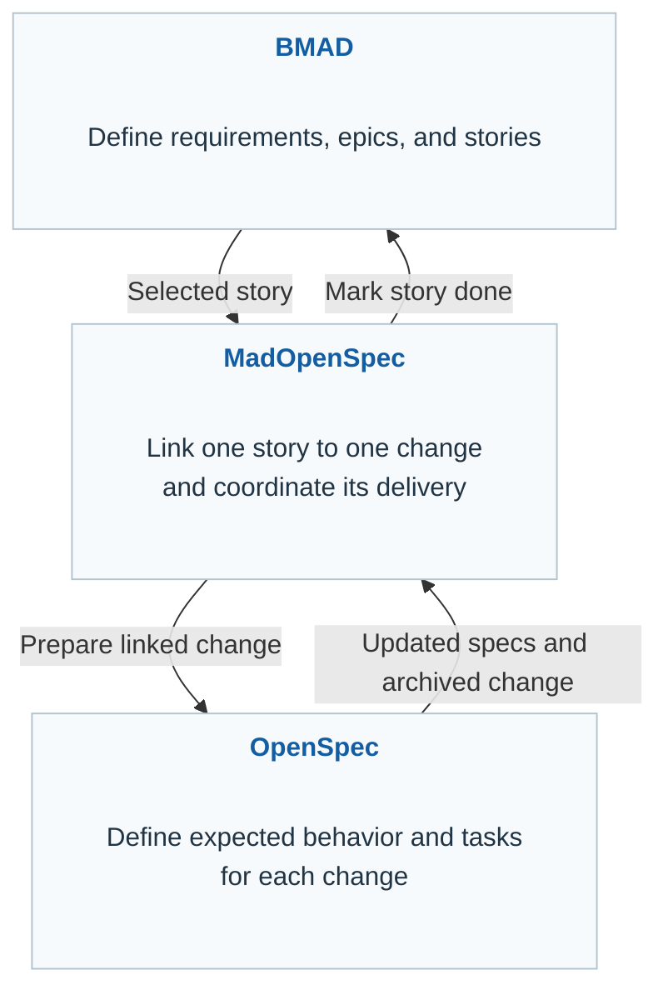

# MadOpenSpec

MadOpenSpec makes spec-driven development (SDD) easier to follow by connecting a plan for what to build with an up-to-date specification of what the project already does. BMAD’s planning tools turn product goals into requirements, epics, and stories. OpenSpec records the expected behavior for each change and keeps the project specs current as stories are completed.

MadOpenSpec links each selected BMAD story to one OpenSpec change. Review the proposed behavior and tasks, implement the story, and run the project checks. When you close the change, MadOpenSpec updates the project specs, archives the change, and marks the story `done` in BMAD.

## How the tools fit together



## Set up the tools

The CLI requires Node.js 22.18.0 or later and npm. BMAD workflows use `uv`. Automatic backlog discovery also needs Python 3.11 or later. Setup installs the supported versions of BMAD (6.12.4) and OpenSpec (1.16.0) and places project skills under `.agents/skills/`.

In a terminal, replace the paths below with your checkout and target project. The alias runs the CLI from source for this shell session.

```sh
cd /absolute/path/to/MadOpenSpec
npm ci
alias mad-openspec='node "/absolute/path/to/MadOpenSpec/bin/mad-openspec.ts"'

cd /absolute/path/to/target-project
mad-openspec setup --dry-run --document-output-language English
mad-openspec setup --document-output-language English
```

This sets up a new project with English documents and Russian BMAD conversations. If your agent's shell cannot resolve the alias, give it the full path to `bin/mad-openspec.ts` to run with Node.js. For a project already using an earlier version, follow [Updating a project](docs/usage.md#update-madopenspec-in-an-existing-project).

## Connect the backlog

If you already have BMAD epics and `sprint-status.yaml`, run the commands below. Starting from an idea? Start your coding agent in the target project and invoke the BMAD skills in order. The examples use `$skill-name`. Adapt that syntax to your agent.

| Goal | BMAD skills |
| --- | --- |
| Define the product | `$bmad-brainstorming` (optional), `$bmad-product-brief`, `$bmad-prd` |
| Design it | `$bmad-ux` (if needed), `$bmad-architecture` |
| Produce the backlog and sprint status | `$bmad-create-epics-and-stories`, `$bmad-sprint-planning` |

From the target project root, connect the files and see which stories are open.

```sh
mad-openspec connect
mad-openspec status
```

## Take one story through implementation

Suppose BMAD story `1.2` calls for exporting a report to CSV.

Invoke each skill in a separate message to your coding agent.

1. **Prepare.** Send `$mad-openspec-prepare story 1.2`. Review the proposal, spec changes, design, and tasks for `story-1-2`. Approve them when they describe the work you want.
2. **Implement.** Send `$mad-openspec-apply story 1.2`. The agent checks prerequisites, implements the tasks, and runs the project's checks. Give each story an explicit dependency field such as `**Dependencies:** none` or `**Dependencies:** Story 1.1`. [Dependency examples](docs/usage.md#story-dependencies)
3. **Close.** After the checks pass, send `$mad-openspec-close story-1-2`. Review the epic checklist, then commit the code, specs, archive, and updated BMAD and MadOpenSpec records together.

For help choosing the next story, send `$mad-openspec-guide`. For CLI commands, JSON reports, and recovery steps, see the [usage guide](docs/usage.md).

## Development

Run the CI checks from the MadOpenSpec checkout.

```sh
npm ci
npm run typecheck
npm test
npm exec -- openspec validate --all --strict
npm run test:smoke
```

The smoke suite exercises the source and packaged CLI in temporary projects. Use `npm run build` to build the CLI separately.

## License

[MIT](LICENSE) © 2026 Ivan Briginas.
